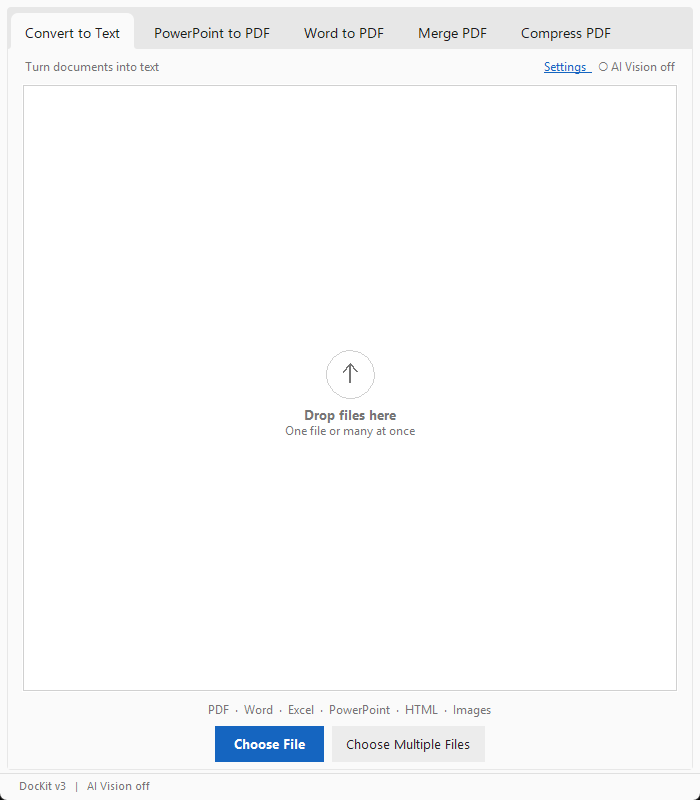
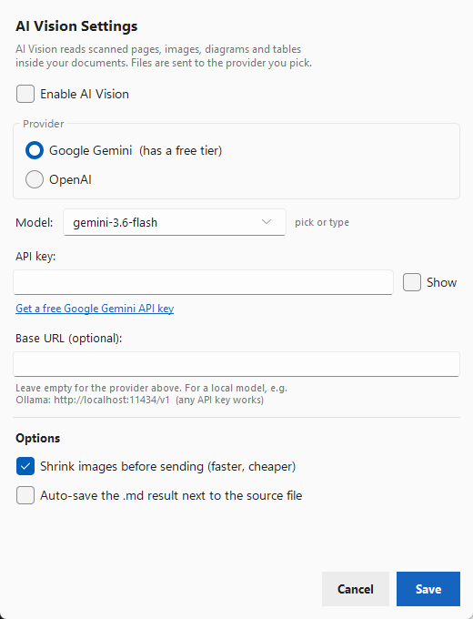

# DocKit

An offline document toolkit for Windows. Convert documents to text (scans included), turn Office files into PDFs, merge PDFs and make them smaller, all in one desktop app. Your files stay on your computer unless you turn on AI Vision.



## What it does

| Tab | What it does | Needs |
|---|---|---|
| **Convert to Text** | PDF, Word, Excel, PowerPoint, HTML, images and more to Markdown or plain text. Copy the result or save it as `.md` / `.txt`. | Nothing extra |
| **PowerPoint to PDF** | Batch-convert `.pptx`, `.ppt`, `.pps` and similar files to PDF. | Microsoft PowerPoint |
| **Word to PDF** | Batch-convert `.docx`, `.doc`, `.rtf`, `.odt` to PDF. | Microsoft Word |
| **Merge PDF** | Combine PDFs in the order you choose. | Nothing extra |
| **Compress PDF** | Shrink a PDF with one of three presets. Text stays sharp because it is never turned into images. If compression would save less than 3% (and under 500 KB), the original is kept. | Nothing extra |

PowerPoint to PDF, Word to PDF and Merge PDF can also compress their output.

### Scans and photos of documents (OCR)

Scanned PDFs and pictures of documents have no text layer, so normal conversion finds nothing. Pick how DocKit reads them in **Settings**:

- **Offline OCR** (default): runs [RapidOCR](https://github.com/RapidAI/RapidOCR) on your computer. It is free, needs no API key and no internet, and takes about 3 seconds per page on a laptop CPU. It is used only for image files and for PDF pages without text, so normal PDFs keep their tables. Best with printed text in English and other languages written in the Latin alphabet.
- **AI Vision**: sends those pages and images to a vision model, which writes out the text and also describes charts and diagrams. Better with handwriting and complex layouts.
  - Works with **Google Gemini** (has a free tier), **OpenAI**, or any **OpenAI-compatible endpoint** through the Base URL field: OpenRouter, or a local model in Ollama or LM Studio, so nothing leaves your machine.
  - The API key is stored in Windows Credential Manager, not in a plain file.
  - If the key is rejected or your quota runs out, DocKit tells you and offers to convert without AI.
- **Off**: only extract text that is already in the file.



## Install

### Option 1: download the app

Download `DocKit.exe` from the [Releases](../../releases) page and run it. You do not need to install anything else.

### Option 2: run from source

Requires Windows 10 or 11 and Python 3.10 or newer.

```powershell
git clone <this repository>
cd dockit
python -m pip install -r requirements.txt
python markitdown_gui.py
```

`DocKit.bat` starts the app without a console window.

## Command line

```powershell
python dockit_cli.py report.pdf scan.pdf --out converted
```

Converts each file to `<name>.md` (offline OCR for scans) and prints a short summary with an outline instead of the whole text. Handy for scripts and for AI assistants that should read only part of a large document.

### Use it from Claude Desktop (MCP)

`dockit_mcp.py` is a local [MCP](https://modelcontextprotocol.io) server. It gives Claude three tools: `convert_document`, `read_converted` and `search_converted`, so Claude converts a file on your computer (offline OCR for scans) and reads only the parts it needs. Add this to `claude_desktop_config.json` (Settings > Developer > Edit Config), using your own paths, then restart Claude Desktop:

```json
{
  "mcpServers": {
    "dockit": {
      "command": "C:\Path\To\python.exe",
      "args": ["C:\Path\To\dockit\dockit_mcp.py"]
    }
  }
}
```

Converted files are saved in `%TEMP%\dockit-parse`, and only those files can be read back. Large scans take a few seconds per page, so a very long scan can hit the client's time limit.

## Build the .exe

```powershell
python -m pip install -r requirements-dev.txt
python -m PyInstaller DocKit.spec --noconfirm
```

The app is written to `dist\DocKit.exe`. Run `create_shortcuts.bat` to add DocKit to the Start Menu (so Windows Search finds it) and the Desktop.

## Tests

```powershell
python -m pytest tests/ -q                            # app tests
python -m pytest packages/markitdown-ocr/tests/ -q    # OCR plugin tests
```

The large stress fixtures (about 105 MB) are not in the repository, so the tests that need them are skipped. To run those tests too, generate the fixtures first:

```powershell
python tests/stress/generate_stress_data.py
python -m pytest tests/stress/ -v
```

## Project layout

```text
markitdown_gui.py        The app: all five tabs (Tkinter)
pdf_optimizer.py         PDF compression engine, no GUI code, usable on its own
packages/markitdown      Document-to-Markdown library (modified, see below)
packages/markitdown-ocr  AI Vision OCR plugin (modified, see below)
tests/                   Unit, integration and stress tests
DocKit.spec              PyInstaller build file
```

## Privacy

- Conversion, offline OCR, PDF merging and compression run entirely on your computer.
- With AI Vision on, page images and embedded images are sent to the provider you chose. With a local Base URL (Ollama, LM Studio), they stay on your machine.
- Logs are written to `%LOCALAPPDATA%\MarkItDown\logs`.

## Credits and license

DocKit is released under the [MIT License](LICENSE).

`packages/markitdown` and `packages/markitdown-ocr` are modified copies of [microsoft/markitdown](https://github.com/microsoft/markitdown) (MIT, Copyright (c) Microsoft Corporation). The changes cover AI Vision error handling, cancellation, progress reporting, image compression and an offline RapidOCR backend. Offline OCR uses [RapidOCR](https://github.com/RapidAI/RapidOCR) (Apache-2.0) and PaddleOCR models (Apache-2.0). DocKit is not affiliated with or endorsed by Microsoft.
